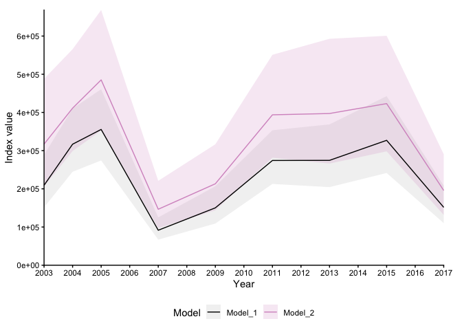
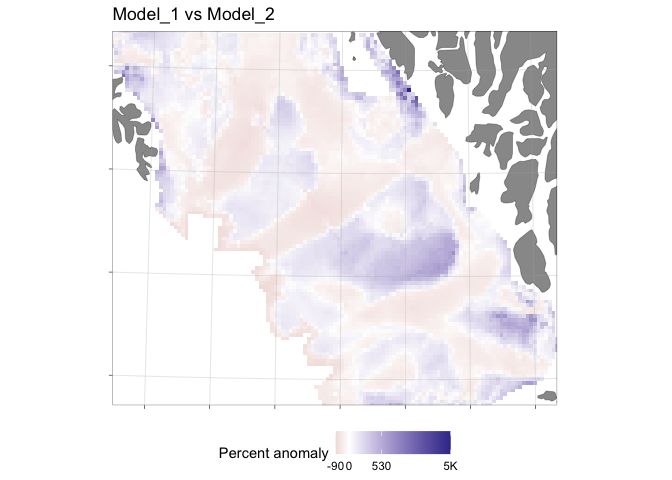

<!-- README.md is generated from README.Rmd. Please edit that file -->

# sdmTMBexperiments

<!-- badges: start -->

[](https://lifecycle.r-lib.org/articles/stages.html#experimental)
[](https://github.com/DeepWaterIMR/sdmTMBexperiments/actions/workflows/R-CMD-check.yaml)
<!-- badges: end -->

**sdmTMBexperiments** is a collection of experimental helper functions
for working with fitted [sdmTMB](https://github.com/sdmTMB/sdmTMB)
models: model comparison, mesh-resolution sensitivity, retrospective
analysis, survey-specific index comparison, prediction-grid
construction, and diagnostic plotting. It doubles as a showcase of how
to use these functions and a staging ground for methods that may later
be adopted into sdmTMB.

The functions may be freely reused. Figures are made using
[ggplot2](https://ggplot2.tidyverse.org/reference/), and can be modified
using ggplot syntax. Maps are drawn on
[ggOceanMaps](https://mikkovihtakari.github.io/ggOceanMaps/) basemaps
when that package is installed. The functions in this package are
experimental and likely contain bugs. If you spot one, please file an
issue or commit a PR.

📖 **[Documentation and full
walkthrough](https://deepwaterimr.github.io/sdmTMBexperiments/)** —
start with [Get
started](https://deepwaterimr.github.io/sdmTMBexperiments/articles/sdmTMBexperiments.html)
for an end-to-end example, or the [function
reference](https://deepwaterimr.github.io/sdmTMBexperiments/reference/)
for individual functions.

## Installation

``` r
# install.packages("remotes")
remotes::install_github("DeepWaterIMR/sdmTMBexperiments")
```

## Example

``` r
library(sdmTMBexperiments)
library(sdmTMB)

mesh <- make_mesh(pcod, c("X", "Y"), cutoff = 20)
m1 <- sdmTMB(
  density ~ 0 + as.factor(year),
  data = pcod,
  time = "year",
  mesh = mesh,
  family = tweedie()
)
m2 <- sdmTMB(
  density ~ 0 + as.factor(year) + depth_scaled,
  data = pcod,
  time = "year",
  mesh = mesh,
  family = tweedie()
)
nd <- replicate_df(qcs_grid, "year", unique(pcod$year))

# Compare two models: indices, spatial prediction differences, Mohn's rho
cmp <- compare_models(m1, m2, newdata = nd, object_crs = 32609)
#> i `ln_tau_O` is an internal parameter affecting `sigma_O`
#> i `sigma_O` is the spatial standard deviation
#> i `ln_tau_E` is an internal parameter affecting `sigma_E`
#> i `sigma_E` is the spatiotemporal standard deviation
#> i `ln_kappa` is an internal parameter affecting `range`
#> i `range` is the distance at which data are effectively independent
#> Warning: package 'future' was built under R version 4.6.1
plot(cmp)
```



``` r
plot(cmp, type = "spatial")
#> Registered S3 method overwritten by 'stars':
#>   method                  from
#>   st_interpolate_aw.stars sf
```



This is only a taste of what’s available — see the [Get started
vignette](https://deepwaterimr.github.io/sdmTMBexperiments/articles/sdmTMBexperiments.html)
for the full walkthrough: retrospective analysis, mesh-resolution
sensitivity, diagnostic plots, prediction grids, and survey-specific
index comparison with the bundled `sebastes` data.

## Citation

The functions can be freely reused in sdmTMB development. If you use
these functions, please cite the function developer (Mikko Vihtakari,
Institute of Marine Research). If you use the package in publications,
please cite it:

``` r
utils::citation("sdmTMBexperiments", auto = as.list(read.dcf("DESCRIPTION")[1, ]))
#> To cite package 'sdmTMBexperiments' in publications use:
#> 
#>   Vihtakari M (2026). _sdmTMBexperiments: Experimental Helper Functions
#>   for 'sdmTMB'_. R package version 0.1.11,
#>   <https://github.com/DeepWaterIMR/sdmTMBexperiments>.
#> 
#> A BibTeX entry for LaTeX users is
#> 
#>   @Manual{,
#>     title = {sdmTMBexperiments: Experimental Helper Functions for 'sdmTMB'},
#>     author = {Mikko Vihtakari},
#>     year = {2026},
#>     note = {R package version 0.1.11},
#>     url = {https://github.com/DeepWaterIMR/sdmTMBexperiments},
#>   }
```

## Use of generative AI

Much of the code, tests and documentation in this package were written
with an AI coding assistant (Claude Opus 5.5, Anthropic) from the
maintainer’s prototypes and instructions. The maintainer reviewed,
tested and accepted all AI-generated material and is responsible for it.
Commits made with AI assistance carry a `Co-Authored-By` line in the Git
history, and each function’s help page has an “AI assistance” section
recording the model that wrote it and the last model that reviewed it in
full. This follows the [rOpenSci policy on generative AI in software
review](https://ropensci.org/blog/2026/02/26/ropensci-ai-policy/).
