# Experiments with sdmTMB models

`sdmTMBexperiments` collects experimental helpers for fitted
[sdmTMB](https://github.com/sdmTMB/sdmTMB) models. This vignette walks
through the main functions, fitting small/fast models throughout so the
whole vignette runs.

``` r

library(sdmTMBexperiments)
library(sdmTMB)
```

## Model comparison

Fit a couple of models and compare their indices and spatial
predictions. Mohn’s rho indicates the summed proportional difference
during the final year and makes only sense when comparing multiple
models. Included here as an example. Note that the
[`plot()`](https://rdrr.io/r/graphics/plot.default.html) functions
return standard [ggplot2](https://ggplot2.tidyverse.org/reference/)
figures and you can add layers or modify them as you would any other
ggplot object.

``` r

mesh <- make_mesh(pcod, c("X", "Y"), cutoff = 20)
m1 <- sdmTMB(
  density ~ 0 + as.factor(year),
  data = pcod,
  time = "year",
  mesh = mesh,
  family = tweedie()
)
m2 <- sdmTMB(
  density ~ 0 + as.factor(year) + depth_scaled,
  data = pcod,
  time = "year",
  mesh = mesh,
  family = tweedie()
)
nd <- replicate_df(qcs_grid, "year", unique(pcod$year))

cmp <- compare_models(m1, m2, newdata = nd, object_crs = 32609)
#> ℹ `ln_tau_O` is an internal parameter affecting `sigma_O`
#> ℹ `sigma_O` is the spatial standard deviation
#> ℹ `ln_tau_E` is an internal parameter affecting `sigma_E`
#> ℹ `sigma_E` is the spatiotemporal standard deviation
#> ℹ `ln_kappa` is an internal parameter affecting `range`
#> ℹ `range` is the distance at which data are effectively independent

# Index time series, annotated with Mohn's rho and modified using ggplot2 syntax
plot(cmp, mohn = TRUE) +
  scale_x_continuous(
    breaks = seq(min(pcod$year), max(pcod$year), by = 2),
    labels = substr(seq(min(pcod$year), max(pcod$year), by = 2), 3, 4)
  )
#> Scale for x is already present.
#> Adding another scale for x, which will replace the existing scale.
```

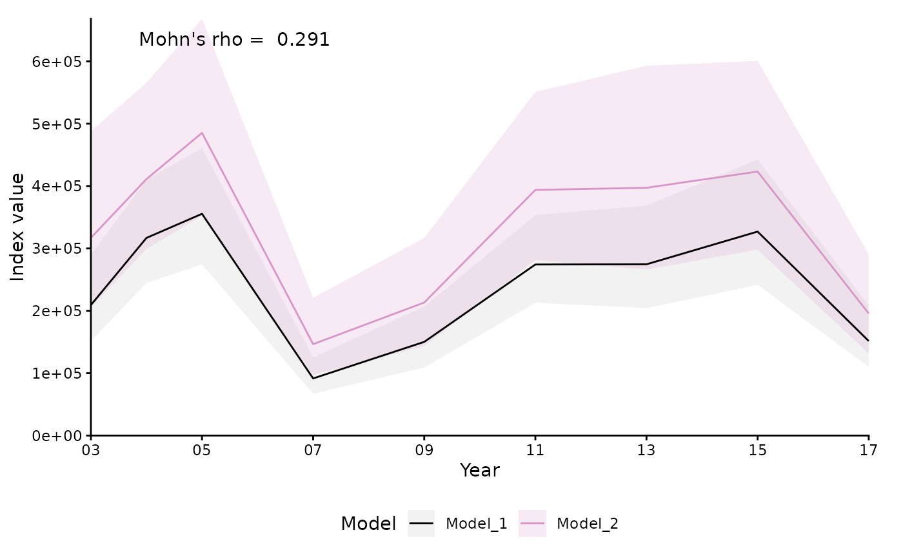

``` r


# per-cell prediction-difference maps
plot(cmp, type = "spatial", fill_prefix = "Biomass density")
```

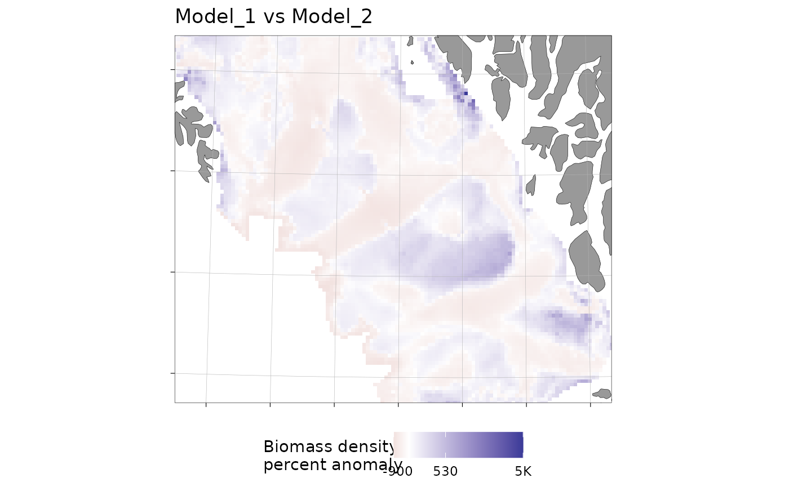

The `spatial_response` argument controls which per-cell summary of the
prediction difference is mapped, since a model comparison typically
spans several years and these need to be summarised down to one map. All
three options are computed from the response-scale (not log-scale)
predictions. `"mean"` is the average absolute difference across years,
in the response’s own units (e.g. density); it is not comparable between
cells with very different baseline abundance. `"mean_pr_diff"` (the
default, used above) is the percent difference between the across-year
*mean* predictions — a ratio of averages, not an average of ratios.
`"pr_mean"` is instead the average of each year’s own percent
difference; because each year is divided by that year’s own reference
value, a handful of low-abundance years/cells can dominate this average
with large, noisy percentages, which is why `"mean_pr_diff"` is the more
robust default. See
[`?plot.sdmTMB_model_comparison`](https://deepwaterimr.github.io/sdmTMBexperiments/reference/plot.sdmTMB_model_comparison.md)
for the exact formulas.

In practice, `"pr_mean"` and `"mean_pr_diff"` are usually close to each
other and can look nearly identical on the map: `m1` and `m2` differ by
a single covariate here, and the reference model’s predictions don’t
swing wildly from year to year within a cell, so a mean-of-ratios and a
ratio-of-means end up similar. They are not identical, though — the two
summaries are highly correlated but diverge most for cells that have at
least one year with an unusually small reference-model estimate, which
inflates that single year’s percent difference in `"pr_mean"` (but not
`"mean_pr_diff"`, which only sees the multi-year average).

``` r

# Aggregate to one value per cell, exactly as plot(..., type = "spatial") does
agg <- cmp$grid[[1]] |>
  dplyr::group_by(X, Y) |>
  dplyr::reframe(
    pr_mean = mean(pr_diff, na.rm = TRUE),
    mean_pr_diff = mean(mean_pr_diff, na.rm = TRUE)
  )
cor(agg$pr_mean, agg$mean_pr_diff)
#> [1] 0.9993678
max(abs(agg$pr_mean - agg$mean_pr_diff))
#> [1] 57.80503

plot(
  cmp,
  type = "spatial",
  fill_prefix = "Biomass density",
  spatial_response = "pr_mean"
)
```

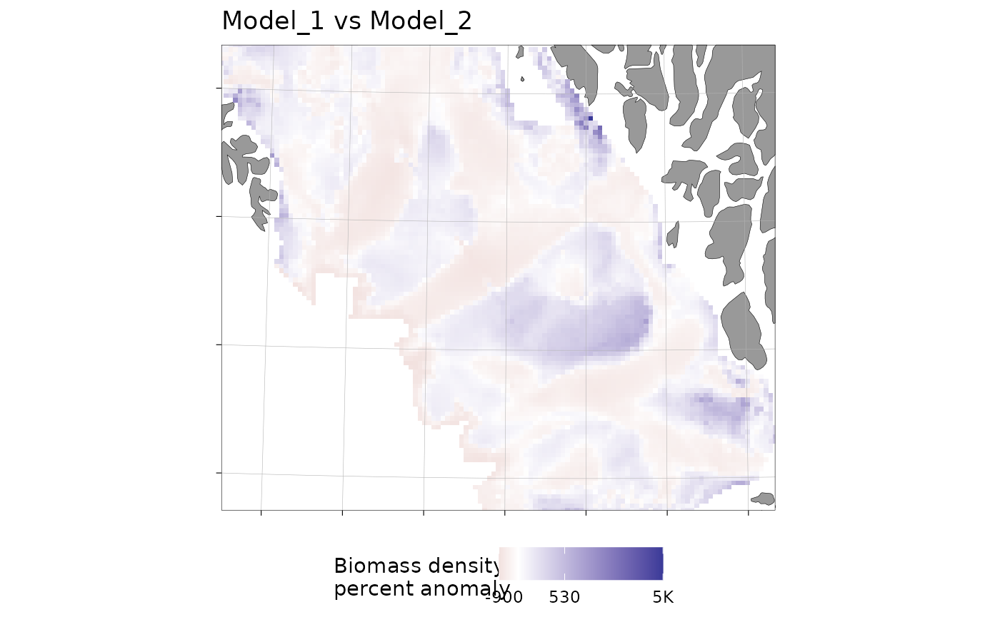

## Diagnostics and result maps

All map helpers render on a
[`ggOceanMaps::basemap()`](https://mikkovihtakari.github.io/ggOceanMaps/reference/basemap.html).
Plotting the SPDE mesh and model results requires knowing the `utm_crs`
used by the
[`sdmTMB::add_utm_columns()`](https://sdmtmb.github.io/sdmTMB/reference/add_utm_columns.html)
function. The X and Y coordinates are divided by 1000 in that function.
The example dataset does not contain information about the UTM zone, but
the information is extracted from sdmTMB examples. In real data, use the
[`sdmTMB::get_crs()`](https://sdmtmb.github.io/sdmTMB/reference/add_utm_columns.html)
function to get the correct UTM zone.

``` r

plot_mesh(mesh, crs = 32609, data = pcod, value = "density")
```

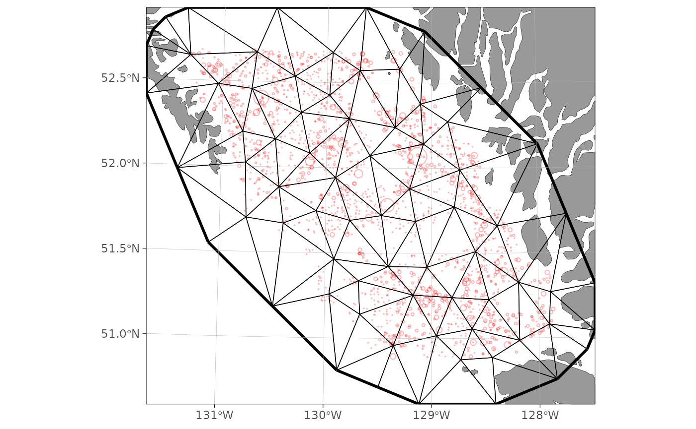

``` r


pred <- predict(m1, newdata = nd, type = "response") # response scale, not link scale
plot_prediction_map(pred, crs = 32609, transform = "sqrt") # density averaged over years
```

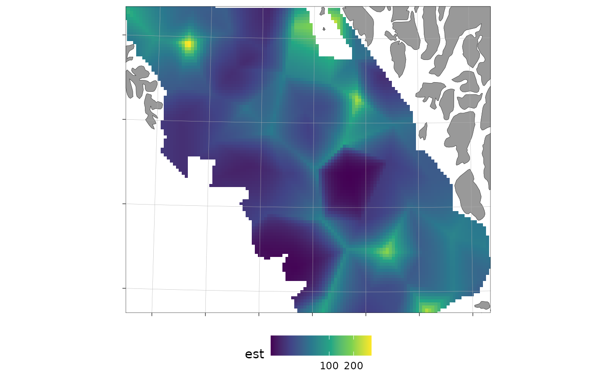

``` r

plot_random_field(pred, crs = 32609, field = "omega") # spatial field
```

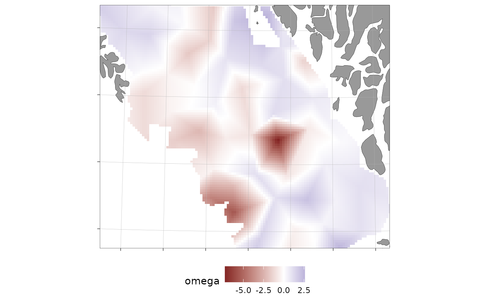

``` r

plot_residual_qq(m1)
```

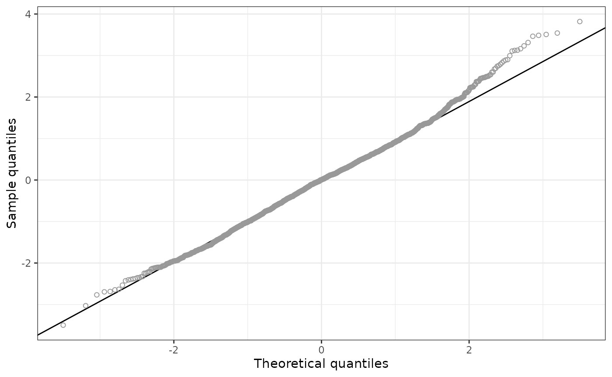

``` r

plot_variance_partitioning(m1)
```

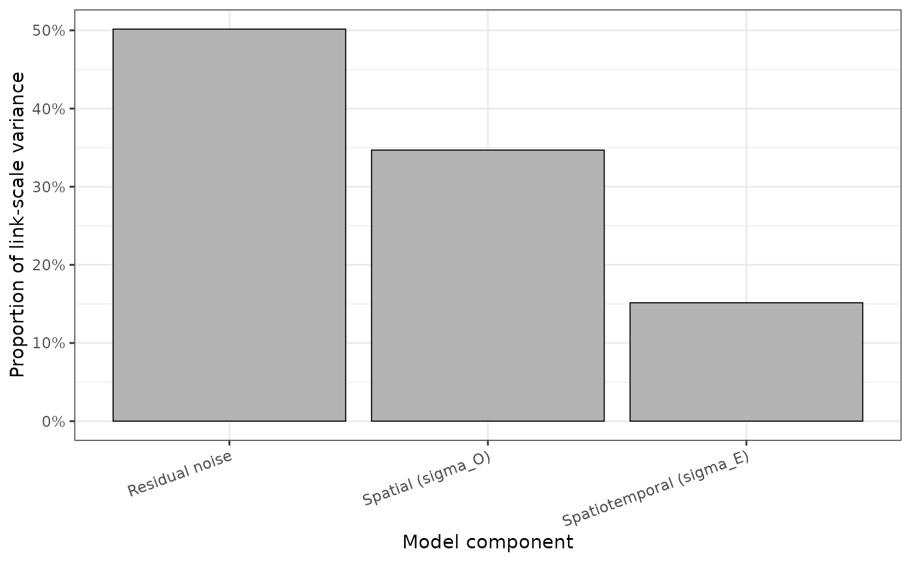

Model diagnostics plots automatically detect delta models and plot all
components. The example below fits a delta model and plots the residuals
and variance partitioning.

``` r

m3 <- sdmTMB(
  density ~ 0 + as.factor(year),
  data = pcod,
  time = "year",
  mesh = mesh,
  family = delta_lognormal()
)

plot_residual_qq(m3)
```

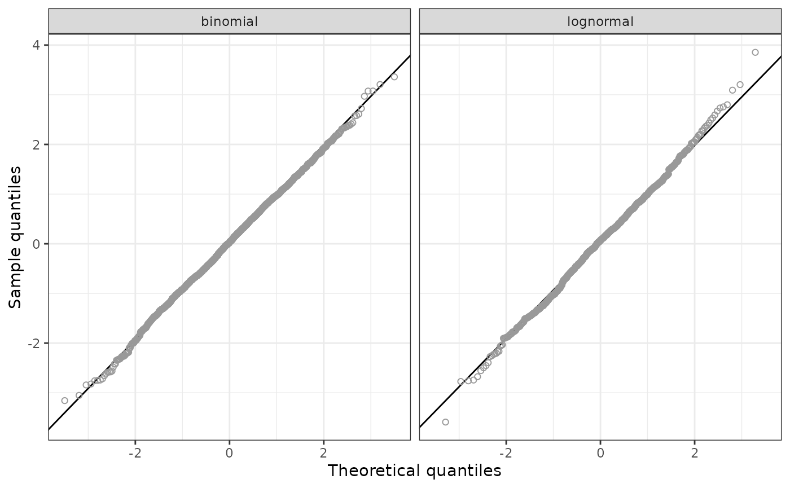

``` r

plot_variance_partitioning(m3)
```

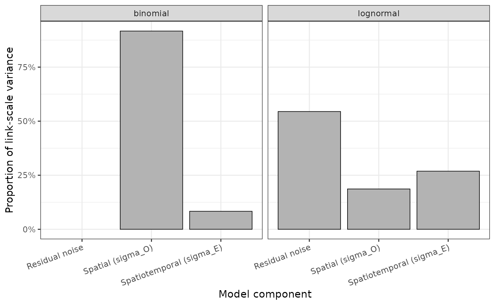

## Mesh-resolution sensitivity

Mesh resolution can affect model results.
[`compare_meshes()`](https://deepwaterimr.github.io/sdmTMBexperiments/reference/compare_meshes.md)
fits a model at multiple mesh resolutions and compares the resulting
indices and spatial predictions. The example below compares two meshes
with cutoffs of 10 and 30 km, using the 20 km mesh as the reference, and
shows how finer mesh size leads to generally lower index estimates.

``` r

mc <- compare_meshes(
  m2,
  mesh_cutoffs = c(10, 30),
  newdata = nd,
  object_crs = 32609,
  reference_name = "20"
)
plot(mc, cutoff_label = "Cutoff (km)")
```

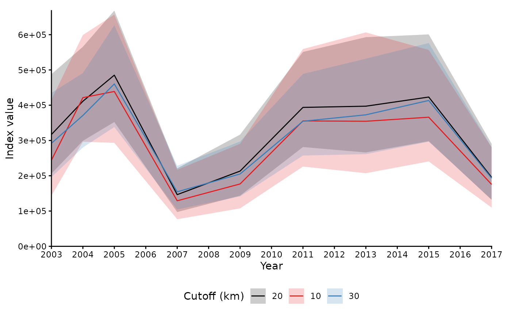

``` r

plot(mc, type = "spatial", spatial_response = "mean")
```

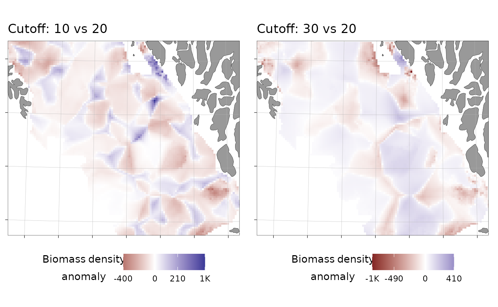

The
[`sdmTMB_mesh_cv()`](https://deepwaterimr.github.io/sdmTMBexperiments/reference/sdmTMB_mesh_cv.md)
performs a block cross-validation of a fitted model at multiple mesh
resolutions. The example below compares the cutoff values in the example
above and indicates that the coarsest mesh would provide the best model
fit, which is somewhat surprising. The function is still very
experimental, however. The
[`blockCV`](https://github.com/rvalavi/blockCV) package is required for
this function.

``` r

# Requires the 'blockCV' package.
cv <- sdmTMB_mesh_cv(m2, mesh_cutoffs = c(10, 20, 30), k = 3)
cv
#> # A tibble: 3 × 10
#>   cutoff crashed converged sanity sum_loglik mean_aic deltaNLL deltaNLL_pr
#>    <int> <lgl>   <lgl>     <lgl>       <dbl>    <dbl>    <dbl>       <dbl>
#> 1     30 FALSE   TRUE      FALSE      -8040.    8752.      0         0    
#> 2     20 FALSE   TRUE      FALSE      -8071.    8676.     31.4       0.391
#> 3     10 FALSE   TRUE      TRUE       -8435.    8561.    395.        4.91 
#> # ℹ 2 more variables: deltaAIC <dbl>, deltaAIC_pr <dbl>
plot(cv)
```

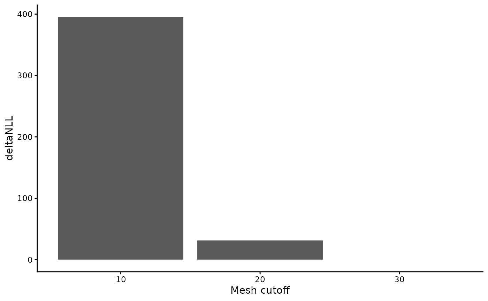

## Retrospective analysis

Retrospective analysis may be required in assessment context to
demonstrate model stability. The
[`sdmTMB_retro()`](https://deepwaterimr.github.io/sdmTMBexperiments/reference/sdmTMB_retro.md)
function fits a model to the full time series, then sequentially removes
the most recent years and refits the model. The example below removes
the last 5 years of data and plots the resulting indices. The
`index_divisor` and `index_unit` arguments are used to scale the index
for plotting.

``` r

retr <- sdmTMB_retro(m1, nd, nyears = 5)
#> Warning in checkNumberOfLocalWorkers(workers): Careful, you are setting up 5
#> localhost parallel workers with only 4 CPU cores available for this R process
#> (per 'system'), which could result in a 125% load. The soft limit is set to
#> 100%. Overusing the CPUs has negative impact on the current R process, but also
#> on all other processes of yours and others running on the same machine. See
#> help("parallelly.maxWorkers.localhost", package = "parallelly") for further
#> explanations and how to override the soft limit that triggered this warning
plot(retr, index_divisor = 1e3, index_unit = "1000 t")
```

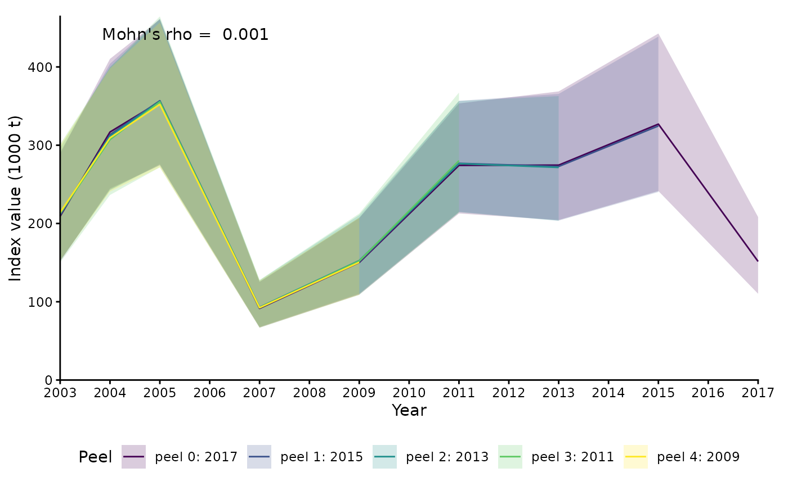

## Prediction grids

The bundled `sebastes` dataset (beaked redfish survey stations) is used
to demonstrate the prediction-grid helpers.
[`make_survey_prediction_region()`](https://deepwaterimr.github.io/sdmTMBexperiments/reference/make_survey_prediction_region.md)
builds a concave hull around a survey’s stations, and
[`make_prediction_grid()`](https://deepwaterimr.github.io/sdmTMBexperiments/reference/make_prediction_grid.md)
lays a regular grid over it. The function can be used to extract depths
and drop cells outside a specified depth range. The example below builds
a prediction region and grid for the EggaN survey series, and extracts
depths from the default bathymetry source (GEBCO 2022).

``` r

data(sebastes)
eggan <- subset(sebastes, cruiseseries == "EggaN")

region <- make_survey_prediction_region(eggan, crs = 32633, concavity = 5)

# the result is an sf object
ggOceanMaps::qmap(region, fill = I(NA))
```

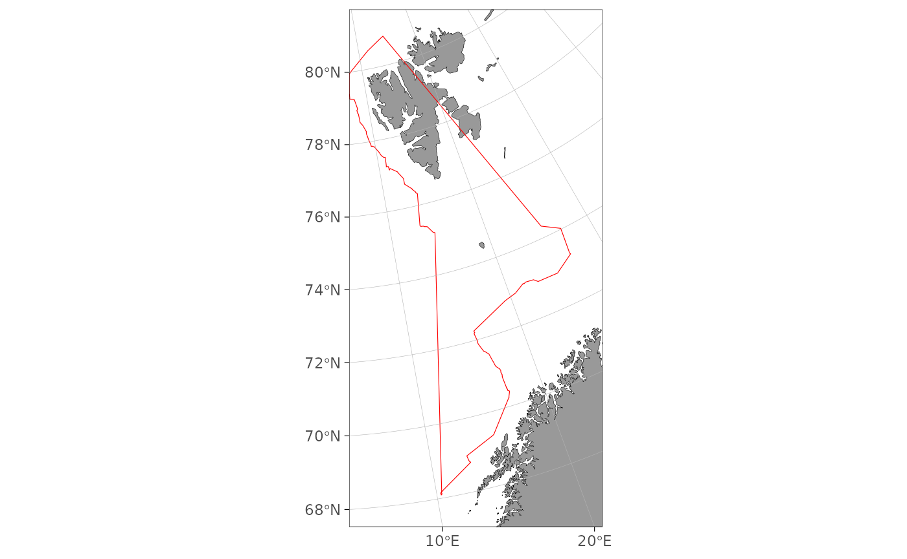

``` r


# max_depth turns on depth extraction, via ggOceanMaps::get_depth() by
# default (bathy_style controls the bathymetry source); cells outside
# c(1, max_depth) are dropped. plot() then colours by depth automatically.
grid <- make_prediction_grid(region, resolution = 20, max_depth = 1000)
range(grid$depth)
#> [1]   2.007292 975.687500
plot(grid)
```

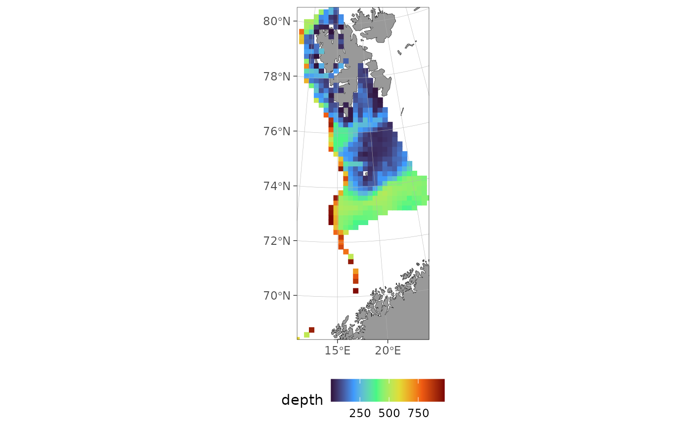

## Survey comparison and prediction grids

When compiling a survey index from multiple survey time-series, it is
often useful to compare the survey-specific indices to the compiled
index to understand which surveys carry the signal in the compiled
index. The
[`compare_surveys()`](https://deepwaterimr.github.io/sdmTMBexperiments/reference/compare_surveys.md)
function fits a model per survey series, builds each survey’s prediction
grid, and compares the survey indices to a compiled reference index. The
example below uses the bundled `sebastes` dataset (beaked redfish survey
stations) to demonstrate this functionality. EcoS and WinterS are the
two series with a coverage over the Barents Sea, so we use those two,
restricted to a few recent years and a coarse mesh to keep this vignette
fast.

Both `compiled_model` and the survey models below are fit with a
`swept_area` offset, so the response is `biomass` (raw catch), not
`density`: `density` is already `swept_area`-normalised
(`density = biomass / swept_area`), so fitting it together with a
`swept_area` offset would double-correct for effort. Predicting onto
`full_grid` (which has no swept-area column) makes
[`predict.sdmTMB()`](https://sdmtmb.github.io/sdmTMB/reference/predict.sdmTMB.html)
print an informational message that it is assuming an offset of zero for
the prediction — this is expected: grid cells aren’t real trawl hauls,
so we deliberately predict at a zero offset (i.e. per 1 swept-area unit,
which is exactly `density`’s definition) and let the `area` argument of
[`get_index_split()`](https://sdmTMB.github.io/sdmTMB/reference/get_index.html)
/
[`compare_surveys()`](https://deepwaterimr.github.io/sdmTMBexperiments/reference/compare_surveys.md)
do the area weighting instead.
[`compare_surveys()`](https://deepwaterimr.github.io/sdmTMBexperiments/reference/compare_surveys.md)
/
[`compare_models()`](https://deepwaterimr.github.io/sdmTMBexperiments/reference/compare_models.md)
/
[`compare_meshes()`](https://deepwaterimr.github.io/sdmTMBexperiments/reference/compare_meshes.md)
already suppress this message internally, so it won’t show when calling
those; it can still show for a *direct*
[`get_index_split()`](https://sdmTMB.github.io/sdmTMB/reference/get_index.html)/[`predict()`](https://rdrr.io/r/stats/predict.html)
call on an offset model, such as `compiled_index` below. `swept_area` is
recorded in square nautical miles (see
[`?sebastes`](https://deepwaterimr.github.io/sdmTMBexperiments/reference/sebastes.md)),
not the km² implied by the `X`/`Y` grid coordinates, so cell areas must
be converted to nautical miles before squaring.

``` r

sub <- subset(sebastes, cruiseseries %in% c("EcoS", "WinterS") & year >= 2020)

# A simple "compiled" full-domain model and index, used as the reference
compiled_mesh <- make_mesh(sub, c("X", "Y"), cutoff = 50)
compiled_model <- sdmTMB(
  biomass ~ 0 + as.factor(year),
  data = sub,
  time = "year",
  mesh = compiled_mesh,
  family = tweedie(),
  spatiotemporal = "iid",
  offset = log(sub$swept_area)
)

region <- make_survey_prediction_region(sub, crs = 32633, concavity = 5)
grid <- make_prediction_grid(region, resolution = 40, max_depth = 500)

plot(grid)
```

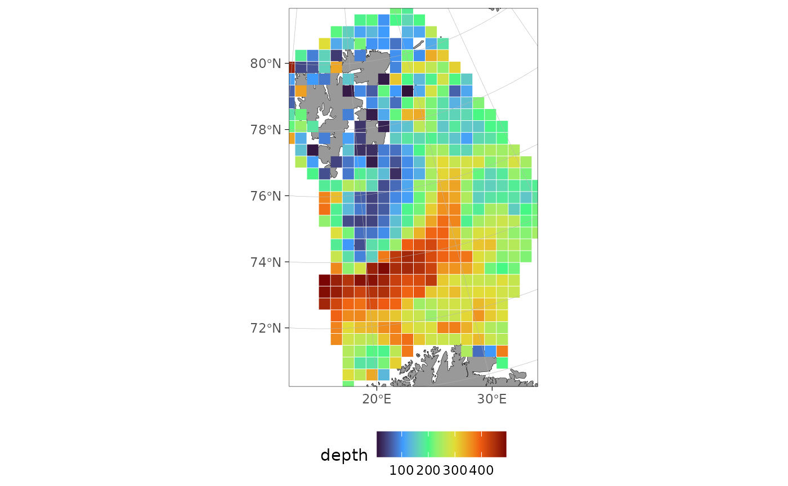

``` r


full_grid <- replicate_df(
  grid,
  "year",
  unique(sub$year)
)

# swept_area is in square nautical miles: convert the 40 km grid resolution
# to nautical miles before squaring, so cell area matches those units.
cell_area <- (40 / 1.852)^2

compiled_index <- get_index_split(
  compiled_model,
  newdata = full_grid,
  area = cell_area,
  silent = TRUE
)

sc <- compare_surveys(
  data = sub,
  compiled_index = compiled_index,
  compiled_model = compiled_model,
  surveys = c("EcoS", "WinterS"),
  newdata = full_grid,
  object_crs = 32633,
  mesh_cutoff = 50,
  offset_col = "swept_area",
  area = cell_area,
  verbose = FALSE
)

plot(sc, index_divisor = 1e6, unit = "kt") # scaled index time series
```

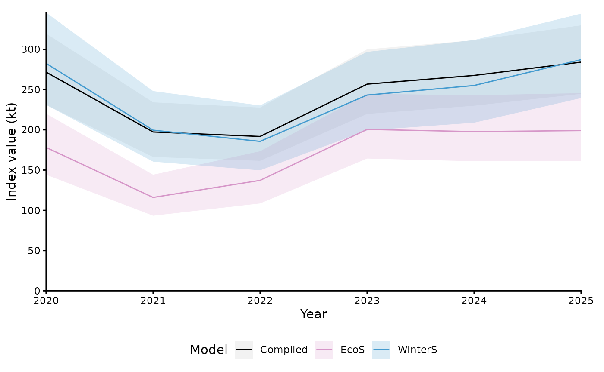

``` r

plot(sc, type = "scatter") # survey vs compiled
```

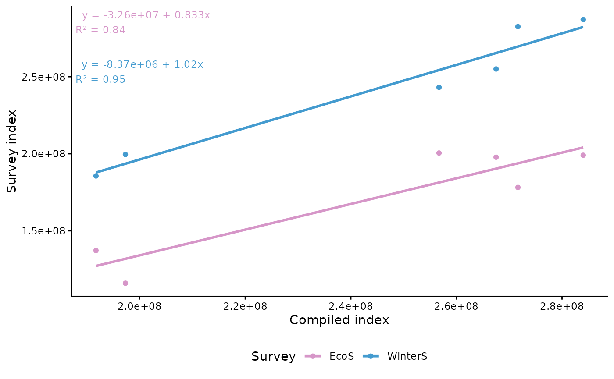

The two prediction-difference maps are tall relative to their width (the
survey domain’s north-south extent is larger than its east-west extent),
so this last plot uses a taller `fig.height` than the defaults above to
fit both side by side without wasted space.

``` r

plot(sc, type = "spatial", spatial_response = "mean") # prediction differences
```

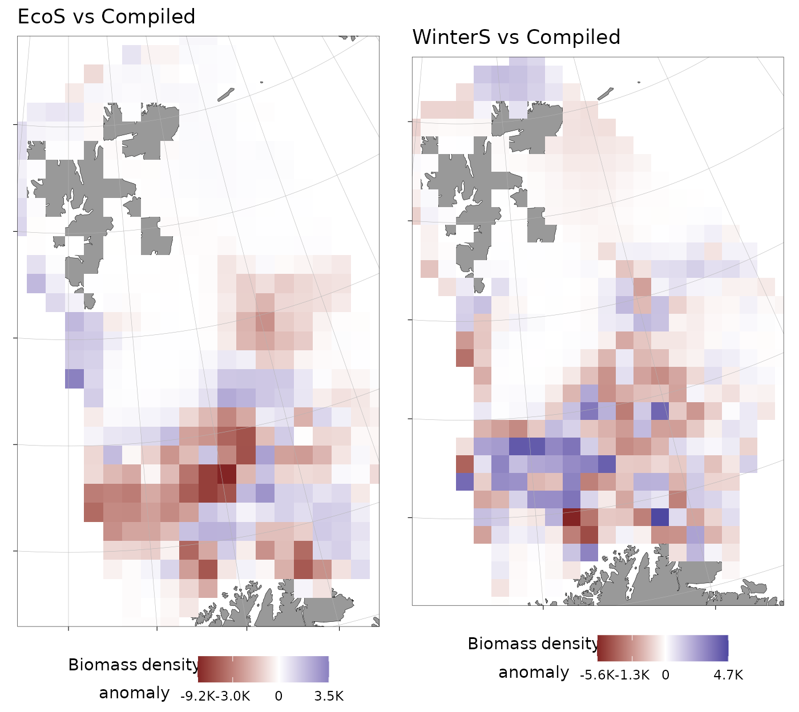

The individual survey indices are lower than the compiled index because
the survey models are fit to a smaller spatial domain than the compiled
model.
